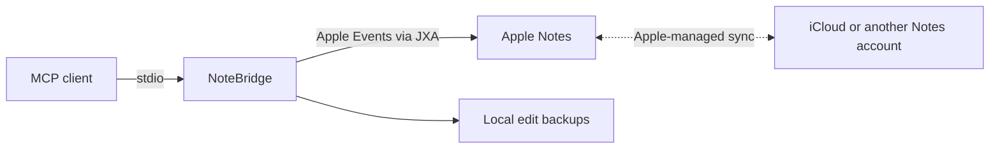

<div align="center">

# NoteBridge

### Your Apple Notes. Your AI. Connected.

Search notes, preserve their formatting, retrieve original attachments, and make versioned edits — through the Model Context Protocol.

[](#quick-start)
[](pyproject.toml)
[](LICENSE)
[](#connect-your-mcp-client)

[Quick start](#quick-start) · [Features](#what-you-can-do) · [Attachments](#original-files-not-just-previews) · [中文](docs/README.zh-CN.md)

</div>

NoteBridge connects an MCP client to the Notes app on your Mac. Choose the folders
it can access, start with read-only tools, and enable editing when you need it.
The server uses Apple's scripting interface and the Python standard library:
**no Python runtime dependencies, no note database scraping, no background indexing.**

## What you can do

| Capability | What you get |
| --- | --- |
| Find a note | Paginated listings, title search, and modification timestamps |
| Read with context | Plain text or exported HTML with styles and attachment references |
| Retrieve original files | Byte-exact native exports, MIME detection, SHA-256, and chunked reads |
| See images | Separate JPEG previews for PNG, JPEG, HEIC and other macOS-supported images |
| Edit deliberately | Create, append, rename, basic formatting, and moves within selected folders |
| Recover an edit | Version checks and private local backups for text and formatting |

Try asking your client:

> Find my note titled “Trip planning” and summarize it.
>
> Read this note with its formatting and show its attached images.
>
> Retrieve the original attachment, including its filename and SHA-256.
>
> Append these decisions to “Project kickoff” after checking its current version.

Search matches **titles**, not full note bodies. Editing is opt-in; deletion is not
exposed. Image previews are derived for display — original file bytes stay separate.

## Quick start

You need **macOS**, **Python 3.9+**, and the built-in **Notes** app. Open Notes and let
your chosen account sync before connecting.

```sh
git clone https://github.com/mqingcs/notebridge.git
cd notebridge
python3 -m venv .venv
. .venv/bin/activate
python -m pip install .
```

Grant Notes Automation permission from the application that will launch the server,
then list folders to select an exact folder ID:

```sh
NOTES_ALLOW_REAL=1 notebridge --notes --request-automation
NOTES_ALLOW_REAL=1 notebridge --notes --folders
```

Start the server:

```sh
NOTES_ALLOW_REAL=1 notebridge --notes \
  --allowed-folder 'YOUR_EXACT_FOLDER_ID'
```

The process waits quietly for an MCP client on stdin. Repeat `--allowed-folder` to
select more folders; subfolders are not included automatically. Local stdio use
requires **no API key**. `apple-notes-mcp` remains available as an equivalent command.

<details>
<summary>Try the included demo without opening Notes</summary>

```sh
python scripts/smoke_test.py
```

Or connect your client to the synthetic server:

```sh
notebridge --fixture fixtures/synthetic.json --allowed-folder folder-demo
```

The fixture runs in memory and does not contact Apple Notes.

</details>

## Connect your MCP client

Add a stdio server to your client's MCP configuration, replacing the two placeholders:

```json
{
  "mcpServers": {
    "notebridge": {
      "command": "/ABSOLUTE/PATH/TO/notebridge/.venv/bin/notebridge",
      "args": ["--notes", "--allowed-folder", "YOUR_EXACT_FOLDER_ID"],
      "env": {"NOTES_ALLOW_REAL": "1"}
    }
  }
}
```

Configuration locations differ by client. Ready-to-adapt examples are in
[`examples/`](examples/). The launcher needs its own macOS Automation permission;
a Terminal permission may not apply to a desktop client or background service.

For remote clients such as ChatGPT, use a separately configured authenticated
private transport. [Deployment guide →](docs/deployment.md)

## Original files, not just previews

Enable attachment tools alongside the optional editing tools:

```sh
NOTES_ALLOW_REAL=1 NOTES_ALLOW_WRITE=1 notebridge --notes \
  --allowed-folder 'YOUR_EXACT_FOLDER_ID' \
  --enable-writes --experimental-attachments
```

The extra attachment flag is retained while native-format and client coverage grows.
Attachment reading itself does not modify notes.

1. Call `apple_notes_list_attachments` to obtain IDs, filenames and content IDs.
2. Call `apple_notes_get_attachment` with the note and attachment IDs.
3. If `next_offset` is present, continue from it with the returned `sha256` as
   `expected_sha256`. Decode each `data_base64` chunk and concatenate in order.
4. Check the reconstructed file against the complete SHA-256.

Each response includes the total file size, MIME type, byte range and original
checksum. Chunks default to **256 KiB**, with up to **4 MiB** per call; that is a
response bound, not a file-size limit. Clients supporting MCP resources can read
the whole original through its `resource_uri`, up to **64 MiB**.

The first image chunk also includes a separate JPEG preview, at most 1,600 pixels
on its longest side. HEIC originals remain HEIC. Unknown file extensions are
transferred unchanged. GPG files remain encrypted; byte retrieval is distinct
from decrypting or interpreting a document.

With `apple_notes_get(..., format="html")`, inline image payloads become SHA-256
references in the exported HTML. Match those hashes to attachment bytes to
reconstruct the image data while retaining the surrounding styles and structure.
Duplicate filenames are distinguished by attachment ID.

## Editing and recovery

Add `--enable-writes` and set `NOTES_ALLOW_WRITE=1` to enable edits. For each edit,
obtain an `expected_version` using `apple_notes_prepare_edit`. The server checks it,
saves a private backup, and rechecks before applying the change.

Backups live in `~/Library/Application Support/Apple Notes MCP/backups` by default.
Use `--backup-dir` or `NOTES_BACKUP_DIR` to change that location. Restore applies to
the text and formatting of an existing attachment-free note.

## Tool reference

| Mode | Tools |
| --- | --- |
| Read-only · 6 | `apple_notes_list`, `apple_notes_search`, `apple_notes_get`, `apple_notes_changes`, `search`, `fetch` |
| Editing · +8 | `apple_notes_capabilities`, `apple_notes_prepare_edit`, `apple_notes_create`, `apple_notes_append`, `apple_notes_edit`, `apple_notes_rename`, `apple_notes_move`, `apple_notes_restore` |
| Attachments · +3 | `apple_notes_list_attachments`, `apple_notes_get_attachment`, `apple_notes_add_attachment` |

## How it works



NoteBridge waits between requests. File exports and previews are temporary and
created on demand; the package installs no background service. Remote access
requires the Mac to stay awake, logged in and connected. This is a bridge to the
Mac app, not a direct iCloud API.

[Architecture →](docs/architecture.md)

## Current limits

- Notes-exported HTML preserves the formatting its scripting interface exposes;
  it is not the complete native Notes document model.
- Native checklist toggling, pinning, tags, folder management, sharing and deletion
  are not implemented. Locked notes are excluded.
- Body replacement is blocked on notes with attachments. Backups cover text and
  metadata, not attachment binaries. Attachment addition remains capped at 256 KiB.
- A cloud-only attachment may need downloading in Notes before export succeeds.
- Version checks are optimistic; avoid simultaneous edits to the same note. After
  a write timeout, inspect the result before retrying.

Real deployment evidence covers core reading/editing and PNG/HEIC original export
with local MCP previews. Other file formats have synthetic byte-transfer coverage.
See [validation scope](docs/validation.md) for the distinction.

## Contributing

Bug reports, client compatibility reports and small focused pull requests are
welcome. Use synthetic notes or files when sharing reproductions.

```sh
python3 -m unittest discover -s tests -v
python3 scripts/smoke_test.py
```

Start with [CONTRIBUTING.md](CONTRIBUTING.md). For vulnerability reports, see
[SECURITY.md](SECURITY.md). Release history lives in [CHANGELOG.md](CHANGELOG.md).

## License

[MIT](LICENSE). Independent project, not affiliated with Apple or OpenAI.
External components retain their own licenses; see [third-party notices](THIRD_PARTY_NOTICES.md).
