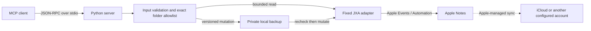

# Architecture and trust boundaries

The optional remote transport is outside this repository. It launches the stdio
server and is responsible for identity, authentication and network isolation.

`server.py` implements framing, initialization, schemas, six read tools and CLI
setup. `writes.py` implements optional mutations, content versioning and backups.
`attachments.py` implements opt-in experimental transfer via private temporary
files. `adapter.js` is fixed source; request JSON is data, never evaluated as code.

The source has no third-party Python runtime imports. Foundation/CoreServices and
Notes belong to macOS; they are not copied into the distribution. Each real request
starts an `osascript` process with a 20-second deadline (60 seconds for attachment export). The server blocks on stdin
between requests. There are no scan timers, resident workers, or network calls in
the server itself.

The Notes app exposes broad Automation capability. macOS does not enforce this
package's read-only mode or folder boundaries: Python/JXA code enforces them.
A local user who can replace the code can change these rules. Protect code and
configuration and trust only clients you want accessing the selected notes.

Before an edit, a snapshot includes body, title, modification time, scope and
attachment metadata. The version is a SHA-256 digest of that snapshot. The server
checks it, writes/fsyncs an owner-private backup, and asks JXA to check again before
mutating. This is optimistic concurrency, not an atomic transaction. A failed
post-write verification does not imply the mutation was rolled back.

Attachment addition is additive; backup/restore cannot remove an added attachment.
Backups carry metadata and HTML/plain text, not the attachment files themselves.
The experimental flag is intentionally distinct from ordinary write enablement.
